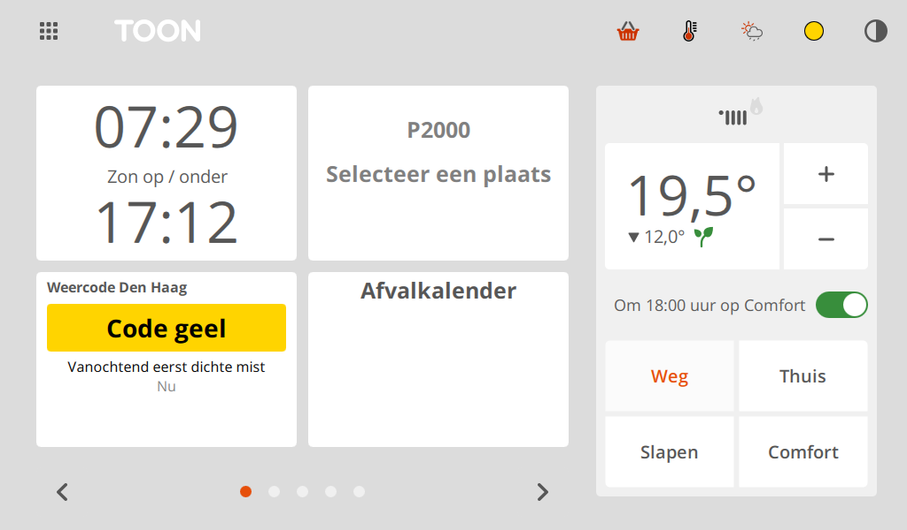
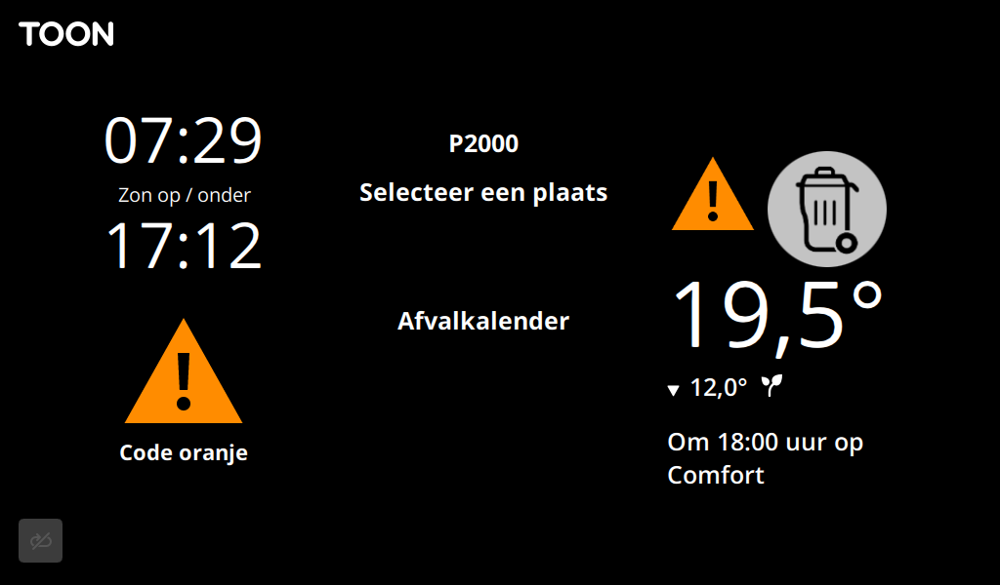
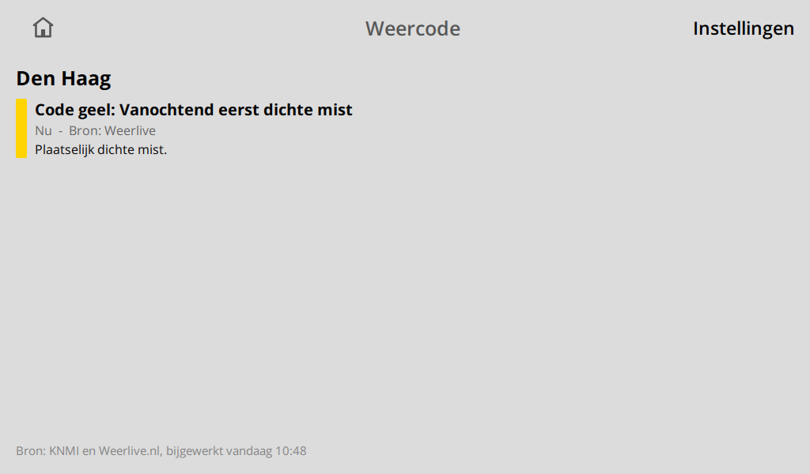
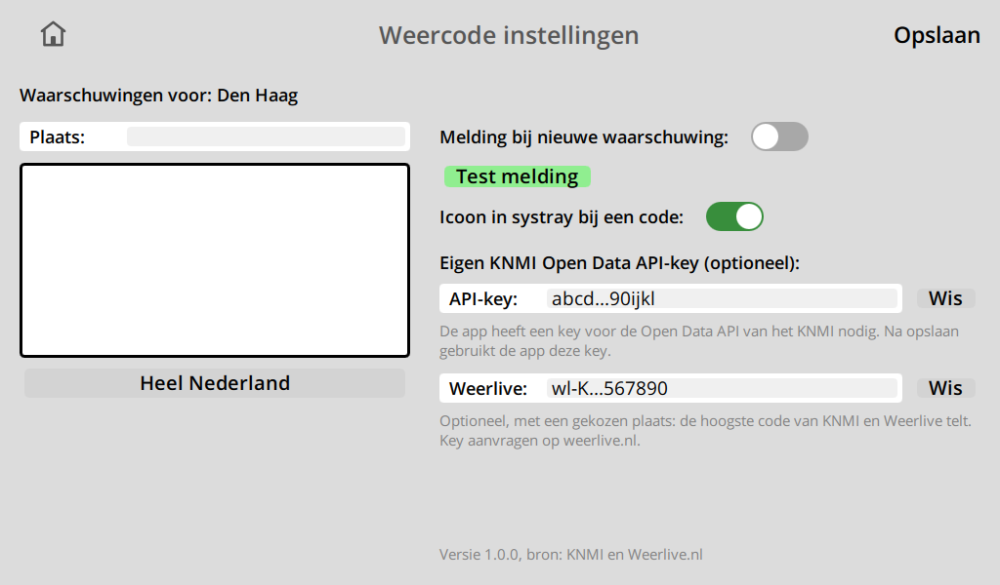
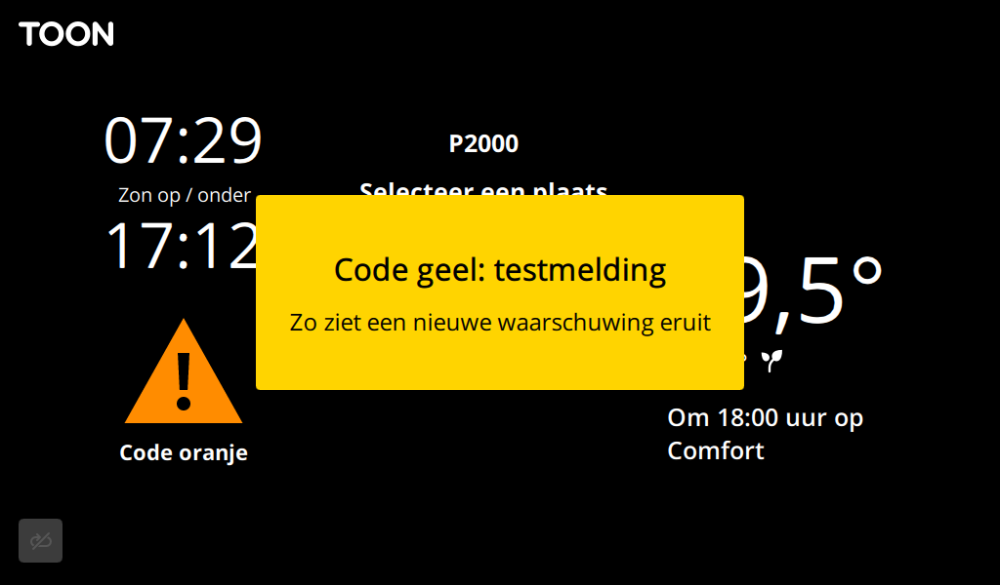

# Weercode for Toon

A Toon app that shows the weather warning codes of the KNMI (geel, oranje, rood) for your place or for
the whole of the Netherlands: on a tile, on a screen, as a notification and as an icon on the dimmed
screen. The warnings come directly from the
[KNMI Data Platform](https://dataplatform.knmi.nl/dataset/knmi-public-weather-warnings-1-0), optionally
together with [Weerlive.nl](https://weerlive.nl/delen.php).

Repository: [github.com/Justin991q/ToonWeercode](https://github.com/Justin991q/ToonWeercode)

## Status

- **KNMI's new dataset goes live on 2 November 2026.** Until then it only holds test data, so the KNMI
  gives the app no real warnings. KNMI can still move that date. With a Weerlive key and a place, the
  app does show real codes before that.
- **Not yet tested on a real Toon** or with real KNMI warnings. It has been tried in the
  [Toon simulator](https://github.com/ToonSoftwareCollective/toonsim), on the Toon 1 and Toon 2 screen
  sizes, against the real KNMI service (which has only test data for now) and made-up warnings.
- KNMI's file format is still at schema version 0.7 and can change.

Until this is proven in practice, use the [KNMI website](https://www.knmi.nl/nederland-nu/weer/waarschuwingen)
for anything that matters.

## What you get

- **A tile** with the code of this moment, what it is for and until when. When no code applies yet but
  one is coming, it says so ("Verwacht: code oranje"). When the app doesn't know the current state, it
  says "Onbekend" and never "Geen waarschuwing".
- **A screen** (tap the tile) with all warnings for your place, most important first: the code, the
  times, the area and KNMI's text. "Mogelijk gevaarlijk weer" is listed separately: KNMI doesn't count
  that as a warning yet, so it doesn't set the code and gives no notification. **Ververs** empties the
  cache and gets everything from the sources again.
- **A notification (optional):** a box in the colour of the code in the middle of the screen for 15
  seconds, also when the screen is dimmed, once per warning. Tap it to close it sooner.
- **On the dimmed screen,** while a code applies now: a big warning triangle on the tile and one above
  the room temperature. The second one is also there without the tile.
- **An icon in the systray (optional):** a dot in the colour of the code, while a code applies.

## Screenshots

The tile on the home screen, with the dot in the systray:



The dimmed screen, with the triangle on the tile and above the temperature, next to the icon of the
waste calendar app:



The screen with the warnings, and the settings screen:





The notification:



The screenshots come from the Toon simulator (Toon 2) with made-up warnings and keys.

## What you need

- A **rooted Toon** (Toon 1 or Toon 2) with the ToonSoftwareCollective (TSC) software, so it can run
  custom apps.
- An **internet connection** on the Toon.
- Optional, but recommended: your own free **KNMI Open Data API key** and **Weerlive API key**. See
  [Which API keys](#which-api-keys).

## Installing

The app isn't in ToonStore, so you install it by hand:

1. **Get the app.** The folder has to be called exactly `weercode`, so name it when you clone:

   ```bash
   git clone git@github.com:Justin991q/ToonWeercode.git weercode
   ```

2. **Copy the `weercode` folder to the Toon**, to `/qmf/qml/apps/weercode`. For example, from a PC with
   an SSH client (use your Toon's IP address):

   ```bash
   scp -r weercode root@192.168.1.10:/qmf/qml/apps/
   ```

   With WinSCP on Windows: connect to the Toon with protocol **SCP**, user `root` and your Toon's root
   password, then drag the folder into `/qmf/qml/apps/`.

   The files go directly inside it: `/qmf/qml/apps/weercode/WeercodeApp.qml`.

3. **Restart the Toon's screen software.** Either use **Restart GUI** in the TSC settings on the Toon,
   or run this over SSH:

   ```bash
   killall qt-gui
   ```

   The screen software starts again by itself within a minute.

4. **Add the tile.** On the home screen, tap an empty spot ("Voeg tegel toe") and choose **Weercode**.

## Settings

Tap the tile, then **Instellingen** at the top right. Changes count after **Opslaan**.

1. **Plaats:** tap the field and type a place name, then tap the place in the list. **Heel Nederland**
   goes back to the whole country, which is also the default. The app then shows the highest code
   anywhere in the country, so also for warnings that aren't near you.
2. **Melding bij nieuwe waarschuwing:** the notification on or off. **Test melding** shows an example.
3. **Icoon in systray bij een code:** the dot on or off.
4. **API-key** and **Weerlive:** your keys, see below. **Wis** empties a field.

The settings screen shows the app's version at the bottom.

## Which API keys

| Key | Needed? | Where to get it |
|---|---|---|
| **KNMI Open Data API** | Optional: without one, the app uses KNMI's public key | Register at the [KNMI Developer Portal](https://developer.dataplatform.knmi.nl/apis) and choose "Request an API key" at **Open Data API**. Each KNMI API has its own request. |
| **Weerlive** | Optional, and only used with a chosen place | Request one at [weerlive.nl](https://weerlive.nl/delen.php) |

**Why your own KNMI key helps:** KNMI's public key is shared by all unregistered users, and valid until
1 August 2027. It is often at its limit, and the app then shows "KNMI is even te druk". Your own key has
its own limit of 1000 requests an hour.

**Typing a long key on the Toon's keyboard** is a lot of work. You can also put it in the settings file
as `apiKey` or `weerliveKey` (see [Files](#files)), and then restart the screen software.

## Where the data comes from

| Source | Used for | How often |
|---|---|---|
| [KNMI Open Data API](https://developer.dataplatform.knmi.nl/open-data-api), dataset `KNMI-public-weather-warnings` | the warnings | the list of files every 10 minutes, 1 to 2 minutes after a failure. Only a new file is downloaded. |
| [Weerlive.nl](https://weerlive.nl/delen.php) | a second source for the code | every 10 minutes: 144 of the 300 requests a day it allows |
| [PDOK Locatieserver](https://www.pdok.nl/) | finding your place and its coordinates | only when you search on the settings screen |

**KNMI:** the app reads the newest 5 files together. Every file has the whole state of its moment; of a
warning only the newest version counts. It checks whether your place lies in a warning's area. A warning
that disappears from the newer files without being cancelled first stays until it has dropped out of
those 5 files or has expired.

**Weerlive:** the highest code of the two sources counts. Weerlive only shows up when it gives a higher
code than KNMI, so a warning isn't listed twice. It keeps the app going when KNMI doesn't answer. It has
no answer for the whole country, no end time ("Nu" instead of "Tot 12:00") and no kind of weather: the
app shows its headline instead. It can lag behind KNMI.

**How up to date it is:** KNMI publishes shortly after issuing a warning, about 1.5 minutes in the two
cases measured on its old dataset. With a check every 10 minutes, the app is at most about 11.5 minutes
behind. KNMI's push service (MQTT) isn't used: its broker requires a WebSocket subprotocol that QML's
WebSocket can't set on this Qt version.

**Cache:** what the app has read is kept on the Toon, so after a restart it shows the last known state at
once and downloads nothing again. A cache of another place or another app version is ignored. When no
source has answered for 30 minutes, the tile says "Onbekend". **Ververs** on the screen empties the cache
right away: until KNMI or Weerlive answers, the app shows no code. One tap costs up to 11 KNMI requests
and 1 Weerlive request. Warnings that have already notified don't notify again.

## Troubleshooting

| What you see | What to check |
|---|---|
| "Geen waarschuwing" while the KNMI website shows one | Before KNMI's switch on 2 November 2026 this is expected without Weerlive: see [Status](#status). Check that the warning covers your chosen place. |
| "KNMI is even te druk" (error 429) | The public key is at its limit. The app tries again within 2 minutes. Use your own key to avoid it. |
| "KNMI weigert de sleutel" | Check your key: it must be for the **Open Data API**. Without your own key, the public key may have expired. |
| "Geen verbinding met het KNMI" | The Toon has no internet, or the answer couldn't be read, for example because KNMI changed its format. |
| "Weerlive weigert de key of plaats" | Check your Weerlive key. Weerlive's demo key only works for one place, and isn't usable here. |
| "Onbekend" stays | No source has answered for 30 minutes: see the line below it on the tile. |
| No notification | Does **Test melding** show one? Is **Melding bij nieuwe waarschuwing** on? Each warning notifies once, also across restarts. |

## Files

| Where | What |
|---|---|
| `/qmf/qml/apps/weercode/` | the app |
| `/mnt/data/tsc/weercode_userSettings.json` | the place, the switches, the API keys and which warnings have notified |
| `/mnt/data/tsc/weercode_cache.json` | the cache |
| `/qmf/qml/apps/weercode/event.json` | the latest notification's text, written by the app |

The API keys are stored as plain text in the settings file.

## Known limitations

- **The same warning can notify twice** after KNMI's switch: once through Weerlive and once through
  KNMI, as the app can't link the two. A Weerlive warning that lasts longer than 24 hours notifies again.
- **Two notifications at once:** if another app that uses the same notification mechanism (such as P2000)
  shows one at the same moment, its box can stay until you tap it.
- **The icon above the temperature** has a fixed position per screen size and assumes the current layout
  of the home screen. The waste calendar app has its icon there through a firmware mod that only works
  for that app. When it shows two kinds of waste, its icon can partly overlap this one.

## Trying it in toonsim

In the [Toon simulator](https://github.com/ToonSoftwareCollective/toonsim), put the folder in
`toonsim\apps\weercode` and start the simulator, or use **TSC > Restart GUI** if it's already running.
The app has no automated tests yet.

## Removing

Delete the folder `/qmf/qml/apps/weercode`, `/mnt/data/tsc/weercode_userSettings.json` and
`/mnt/data/tsc/weercode_cache.json`, then restart the screen software.

## Credits

Warning data: [KNMI](https://www.knmi.nl), [CC BY 4.0](https://creativecommons.org/licenses/by/4.0/).
Weather data: [Weerlive.nl](https://weerlive.nl), for private use. Places:
[PDOK](https://www.pdok.nl/). The notification and the input controls follow the
[P2000 app](https://github.com/oepi-loepi/p2000) by oepi-loepi.
